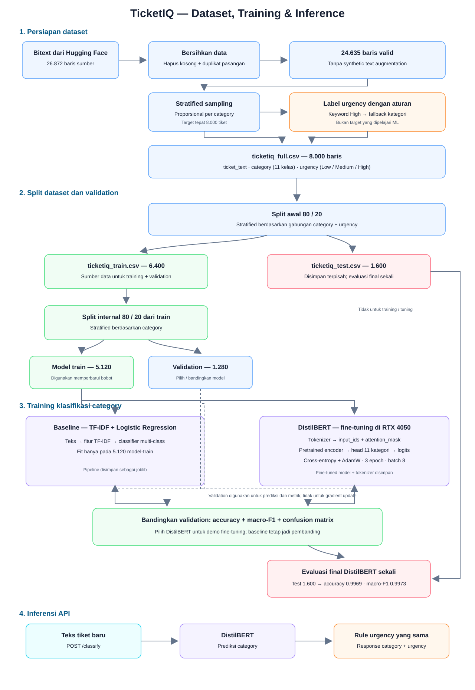

# TicketIQ — Python & Machine Learning

Dokumen ini khusus menjelaskan environment Python dan machine learning
TicketIQ: setup dependency, persiapan dataset, training, evaluasi, dan FastAPI.
Panduan NestJS akan ditambahkan terpisah saat tahap backend dimulai.

TicketIQ mengklasifikasikan **kategori tiket** menggunakan ML. Nilai
`urgency` tidak diprediksi model; urgency dihitung dengan aturan yang
transparan setelah kategori diketahui.

## Gambaran alur



## 1. Kebutuhan environment

Contoh perintah di bawah menggunakan **Windows PowerShell** dan Python 3.14
(teruji pada Python 3.14.2).
Training DistilBERT pada proyek ini membutuhkan NVIDIA GPU yang terdeteksi
CUDA. Environment yang dipakai untuk training adalah Python 3.14, PyTorch
2.11.0+cu128, dan CUDA runtime 12.8. Driver NVIDIA harus mendukung runtime
tersebut.
Jalankan perintah setup dari root repository `TicketIQ`.

Periksa Python, pip, dan driver GPU:

```powershell
py -3.14 --version
nvidia-smi
```

Buat virtual environment lokal, aktifkan, lalu pasang dependency training:

```powershell
py -3.14 -m venv .venv
.\.venv\Scripts\Activate.ps1
python -m pip install --upgrade pip
python -m pip install -r .\ml-service\requirements-training.txt
```

Jika PowerShell menolak aktivasi script, izinkan aktivasi hanya untuk sesi
PowerShell saat ini:

```powershell
Set-ExecutionPolicy -Scope Process -ExecutionPolicy Bypass
.\.venv\Scripts\Activate.ps1
```

Pastikan PyTorch melihat RTX 4050:

```powershell
python -c "import torch; print('PyTorch:', torch.__version__); print('CUDA runtime:', torch.version.cuda); print('CUDA available:', torch.cuda.is_available()); print('GPU:', torch.cuda.get_device_name(0) if torch.cuda.is_available() else 'not detected')"
```

`CUDA available` harus bernilai `True` sebelum menjalankan `train_models.py`.
Training script sengaja berhenti jika CUDA tidak tersedia. API inference berbeda:
API dapat memakai CPU jika CUDA tidak tersedia, walau inference CPU lebih lambat.

Untuk dependency FastAPI, pasang:

```powershell
python -m pip install -r .\ml-service\requirements-api.txt
```

### Library utama

| Library | Digunakan untuk |
|---|---|
| `datasets` | Mengambil dataset Bitext dari Hugging Face |
| `pandas` | Membersihkan dan mengolah data tabular/CSV |
| `scikit-learn` | Stratified split, TF-IDF, Logistic Regression, dan metrik evaluasi |
| `torch` | Training dan inference tensor/model; memakai CUDA untuk DistilBERT |
| `transformers` | Tokenizer dan model pretrained/fine-tuned DistilBERT |
| `joblib` | Menyimpan pipeline baseline TF-IDF + Logistic Regression |
| `fastapi` | Mendefinisikan endpoint HTTP `/classify` |
| `uvicorn` | Menjalankan aplikasi FastAPI sebagai ASGI server |
| `httpx` | HTTP client yang tersedia untuk pengujian service |

Dependency training tercatat di
[`requirements-training.txt`](requirements-training.txt), sedangkan dependency
API di [`requirements-api.txt`](requirements-api.txt). Saat ini manifest API
menyertakan manifest training agar satu virtual environment dapat menjalankan
pipeline lengkap; untuk deployment API terpisah, dependency runtime dapat
dipisahkan dan diperkecil.

Environment virtual, dataset CSV hasil generasi, model hasil training, dan
hasil evaluasi final test tidak dimasukkan ke Git. Aturan ini ada di
[`.gitignore`](../.gitignore): environment dan output besar dapat dibuat ulang,
sementara laporan final test tetap dicatat di README.

## 2. Dataset dan labeling

Sumbernya adalah
[Bitext Customer Support LLM Chatbot Training Dataset](https://huggingface.co/datasets/bitext/Bitext-customer-support-llm-chatbot-training-dataset),
diambil melalui library `datasets`. Dataset sumber memiliki 26.872 baris dan
field `instruction` serta `category` yang dipakai proyek.
Panduan proyek mencatat lisensi sumber sebagai CDLA-Sharing 1.0; periksa syarat
lisensi dan atribusi sebelum mendistribusikan ulang data.

Skrip [`prepare_dataset.py`](prepare_dataset.py) melakukan hal berikut:

1. Memilih `instruction` dan `category`, menghapus nilai kosong, merapikan
   whitespace, dan menghapus duplikat pasangan teks-kategori.
2. Menyisakan 24.635 baris unik yang valid.
3. Mengambil tepat 8.000 tiket dengan **stratified sampling per kategori**.
   Jumlah tiket dari setiap kategori mengikuti proporsi kategori di sumber.
4. Mengubah nama `instruction` menjadi `ticket_text`.
5. Mengisi `urgency` dengan rule-based labeling dari
   [`urgency_rules.py`](urgency_rules.py).

**Augmentasi teks tidak dilakukan.** Proyek tidak membuat variasi sintetis,
terjemahan, atau paraphrase. Stratified sampling hanya memilih subset yang
representatif; itu bukan text augmentation.

Rule urgency memeriksa keyword darurat lebih dahulu: `urgent`, `urgently`,
`asap`, `immediately`, `right now`, `not working`, `broken`, `fraud`,
`fraudulent`, `unauthorized`, `locked out`, `lost`, `stolen`, `charged twice`,
`scam`, `angry`, `furious`, `complain`, atau `complaint`. Kombinasi kata
`refund` dengan `now`, `asap`, atau `immediately` juga menghasilkan `High`.
Jika tidak ada keyword yang cocok, kategori dipakai sebagai fallback:
`REFUND`, `PAYMENT`, `CANCEL` menjadi `High`; `ACCOUNT`, `ORDER`, `SHIPPING`,
`INVOICE`, `SUBSCRIPTION`, `CONTACT` menjadi `Medium`; `FEEDBACK` dan
`DELIVERY` menjadi `Low`. Karena label urgency dibuat dengan rule, urgency
bukan target ML.

Kolom akhir CSV: `ticket_text`, `category`, `urgency`. Sebelas target
`category`: `ACCOUNT`, `ORDER`, `REFUND`, `CONTACT`, `PAYMENT`, `FEEDBACK`,
`SHIPPING`, `INVOICE`, `DELIVERY`, `SUBSCRIPTION`, `CANCEL`.

## 3. Pembagian train, validation, dan test

Ada dua split yang berbeda:

1. **Split awal dataset:** 8.000 tiket dibagi menjadi 6.400 `train` dan
   1.600 `test`, dengan stratifikasi berdasarkan kombinasi
   `category + urgency`. Test disimpan di `data/ticketiq_test.csv`.
2. **Split untuk memilih model:** skrip training membagi 6.400 baris train
   menjadi 5.120 `model_train` dan 1.280 `validation`, stratified berdasarkan
   `category`. Validation digunakan untuk membandingkan model.

Test tidak digunakan untuk training atau pemilihan model. Setelah DistilBERT
dipilih, test digunakan **satu kali** untuk evaluasi final. Jangan retrain atau
tuning berdasarkan hasil test.

### Membuat dataset

```powershell
python .\ml-service\prepare_dataset.py
```

Skrip menghasilkan:

| File | Baris | Peran |
|---|---:|---|
| `ml-service/data/ticketiq_full.csv` | 8.000 | Dataset hasil sampling dan labeling |
| `ml-service/data/ticketiq_train.csv` | 6.400 | Sumber data untuk model train dan validation |
| `ml-service/data/ticketiq_test.csv` | 1.600 | Test final yang ditahan |

Skrip juga memeriksa ukuran, kolom, nilai kosong, duplikat, dan pemisahan
train/test.

## 4. Model dan proses training

### Baseline: TF-IDF + Logistic Regression

TF-IDF mengubah kata pada teks menjadi fitur numerik. Logistic Regression
kemudian mempelajari hubungan fitur tersebut dengan label `category`. Keduanya
disimpan bersama sebagai satu pipeline agar preprocessing dan prediksi konsisten.

### DistilBERT

[`train_models.py`](train_models.py) memuat pretrained `distilbert-base-uncased`
dan menambahkan classification head untuk 11 kategori:

1. Tokenizer mengubah teks menjadi `input_ids` dan `attention_mask`.
2. Token masuk ke embedding dan enam Transformer encoder DistilBERT untuk
   menghasilkan representasi kontekstual.
3. Representasi token `[CLS]` masuk ke classification head, yang menghasilkan
   11 nilai logit—satu per kategori.
4. Selama fine-tuning, logit dibandingkan dengan label kategori yang benar.
   Loss cross-entropy dihitung dan AdamW memperbarui bobot model.
5. Proses berjalan 3 epoch. Validation hanya dipakai untuk mengukur performa,
   bukan untuk menghitung gradient atau memperbarui bobot.

Konfigurasi training yang dipakai: batch size `8`, learning rate `2e-5`,
maksimum `128` token, random seed `42`, dan device CUDA. Classification head
untuk kategori dibuat baru; bobot pretrained DistilBERT di-fine-tune dengan data
tiket.

Jalankan training **sebelum evaluasi final test**:

```powershell
python .\ml-service\train_models.py
```

Skrip melatih baseline dan DistilBERT dari `ticketiq_model_train.csv`, mengukur
keduanya pada `ticketiq_validation.csv`, lalu menyimpan model, accuracy,
macro-F1, dan confusion matrix. Test CSV tidak dimuat oleh skrip training.

## 5. Hasil yang tercatat

Skor validation digunakan untuk membandingkan model:

| Model | Validation Accuracy | Validation Macro-F1 |
|---|---:|---:|
| TF-IDF + Logistic Regression | 0.9953 | 0.9948 |
| DistilBERT | 0.9984 | 0.9987 |

DistilBERT dipilih untuk disajikan karena menunjukkan fine-tuning transformer
end-to-end. Baseline tetap disimpan sebagai pembanding yang lebih ringan.
Skor tinggi pada dataset berbasis template tidak menjamin performa yang sama
pada tiket nyata.

Evaluasi final DistilBERT pada 1.600 tiket test telah dilakukan satu kali:

| Model | Test Accuracy | Test Macro-F1 |
|---|---:|---:|
| DistilBERT | 0.9969 | 0.9973 |

Angka test tersebut adalah hasil final proyek. Evaluator
[`evaluate_test_once.py`](evaluate_test_once.py) menolak berjalan lagi jika
hasil evaluasi final sudah tersimpan.

### File penting

| Path | Isi |
|---|---|
| `ml-service/data/` | CSV dataset hasil generasi; tidak disimpan di Git |
| `ml-service/models/tfidf_logistic_regression.joblib` | Pipeline baseline; dibuat ulang saat training |
| `ml-service/models/distilbert/` | Bobot, config, dan tokenizer; dibuat ulang saat training |
| `ml-service/reports/validation_scores.csv` | Skor perbandingan validation |
| `ml-service/reports/test_scores.csv` | Skor final test lokal; dibuat setelah evaluasi satu kali |
| `ml-service/reports/*confusion_matrix.csv` | Confusion matrix model |

## 6. Menjalankan FastAPI

API menggunakan DistilBERT tersimpan dan fungsi urgency bersama yang juga
dipakai saat membuat dataset. Model dimuat sekali saat service mulai.

```powershell
Set-Location .\ml-service
python -m uvicorn api.main:app --host 127.0.0.1 --port 8000
```

Request:

```json
{
  "ticket_text": "I need help with my payment"
}
```

Response:

```json
{
  "category": "PAYMENT",
  "urgency": "High"
}
```

Urutan inferensi adalah: teks tiket → DistilBERT memprediksi kategori →
`assign_urgency()` menerapkan rule → API mengembalikan kategori dan urgency.
Dokumen ini hanya mencakup service Python; integrasi NestJS akan
didokumentasikan pada tahap backend.

## Urutan menjalankan pipeline

Untuk menyiapkan ulang environment ML pada checkout bersih, aktifkan virtual
environment seperti di bagian pertama, lalu jalankan pipeline dengan urutan:

```powershell
python .\ml-service\prepare_dataset.py
python .\ml-service\train_models.py
python .\ml-service\evaluate_test_once.py
Set-Location .\ml-service
python -m uvicorn api.main:app --host 127.0.0.1 --port 8000
```

Pada checkout bersih, dataset/model dan hasil evaluasi test diabaikan Git lalu
dibuat lokal oleh skrip. Evaluator dapat berjalan sekali karena hasil test
belum ada. Setelah `ml-service/reports/test_scores.csv` dibuat, jangan jalankan ulang
training model terpilih atau evaluator test pada checkout tersebut. Di salinan
kerja proyek ini, evaluasi final sudah dilakukan; gunakan angka yang tercatat
di atas dan jangan mengulang evaluasinya. Eksperimen baru yang mengubah model
atau konfigurasi memerlukan test set baru yang belum pernah digunakan.
